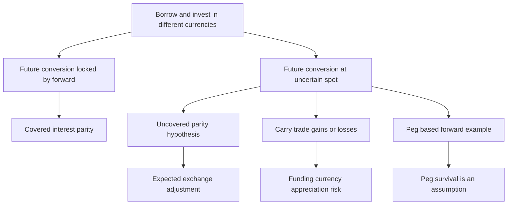

# Derive covered interest parity with explicit currency and time units

## Record metadata

```json
{
  "schema_version": 3,
  "owner": "plan",
  "course_id": "2026_2027/Winter_Semester/Financial_Markets_Instruments_I",
  "transaction_id": "PLAN-20261018-FMI-P004",
  "plan_version": "P004",
  "source_version": "V003",
  "ingestion_revision": 3,
  "objective_id": "O016",
  "objective_revision": 1,
  "criterion_version": "O016-C1",
  "status": "ready",
  "lesson_content_contract": "self-contained-lessons-v1",
  "knowledge_components": [
    "covered_currency_cashflows_and_ratio",
    "exact_approximate_difference_and_premium",
    "arbitrage_direction_and_quotation_time_limits"
  ],
  "prerequisite_ids": [
    "O014",
    "O010"
  ],
  "compatible_versions": [],
  "note_locations": [
    {
      "path": "01_Notes/2026_2027/Winter_Semester/Financial_Markets_Instruments_I/Week_3/Currency_Parity_and_Carry_Trade.md",
      "heading": "Currency parity and carry trade"
    },
    {
      "path": "01_Notes/2026_2027/Winter_Semester/Financial_Markets_Instruments_I/Week_3/Currency_Parity_and_Carry_Trade.md",
      "heading": "Covered interest parity with dollars per euro"
    }
  ],
  "acquisition_rule": {
    "distinct_independent_passes": 2,
    "required_item_roles": [
      "full_capability_check",
      "full_capability_check"
    ],
    "allowed_routes": [
      [
        "O016-I1",
        "O016-I2"
      ],
      [
        "O016-I1",
        "O016-D1"
      ],
      [
        "O016-I1",
        "O016-D2"
      ],
      [
        "O016-I2",
        "O016-D1"
      ],
      [
        "O016-I2",
        "O016-D2"
      ],
      [
        "O016-D1",
        "O016-D2"
      ]
    ]
  },
  "delayed_rule": {
    "minimum_elapsed_hours": 24,
    "fresh_item": true,
    "independent_required": true
  },
  "review_topic": "Derive covered interest parity with explicit currency and time units",
  "review_instruction": "Begin a closed-note review with teach for O016; request an unused prepared delayed item before recap."
}
```

## Outcome and conditions

Match debt, deposits and forward currency amounts to derive covered parity, compute exact/approximate premium measures and identify covered arbitrage direction under stated assumptions. All essential components listed in metadata are required. Hypothetical assessment values instantiate the checked equations; they are not historical observations or current contract terms. Independent checks are closed-note and without hints, solution access, external retrieval or other assistance; a basic arithmetic calculator is allowed. Teach establishes and records actual help/exposure conditions before claiming independence.

## Prerequisites and checks

- [O014 outcome and repair route](../lessons/O014.md#outcome-and-conditions): zero-investment replication and feasibility must be understood before its financial application.
- [O010 outcome and repair route](../lessons/O010.md#outcome-and-conditions): quotation and delivery-currency units determine the forward ratio.

O016-P1, item_version 1, prerequisite_diagnostic. **Prompt:** At $1.20\ \mathrm{USD/EUR}$, how many dollars buy EUR 2? What does a higher USD/EUR forward mean for the euro price? Why does zero opening cash alone not establish fair pricing, and what must the two reversible terminal packages satisfy?

**Complete key and rubric:** $2(1.20)=2.40$ USD; the euro is dearer in dollars forward, a euro premium. Zero opening cash alone does not exclude later loss/gain; feasible reverse packages with certain opposite terminal payoffs plus no-arbitrage force zero payoff at parity. Require units, premium interpretation and this O014 replication condition; repair O010 for quotation/delivery and O014 for reversible cash replication. Pass requires every requested reason and result; partial for an omitted reason or unresolved isolated arithmetic slip; fail for the conflicting mechanism. This diagnostic never counts as acquisition. Current or explicitly compatible committed independent prerequisite evidence may permit skipping its check; familiarity alone cannot. Use the cited complete prerequisite lesson or the named included foundation, then the worked example, after a partial/failing entry check.

## Teaching order and rationale

1. Use the diagnostic once to establish the necessary cash-flow/quotation foundation.
2. Present the complete checked-note explanation below, preserving variables, dates, assumptions and source qualifications. Follow one dated strategy at a time so cancellation is visible.
3. Work W1 fully, asking the learner to explain why each step follows.
4. Use S1 as completion practice: show the setup and first identity, hide the final algebra/numbers and interpretation. After an explanation of the missing steps, withdraw support.
5. Present unused I1/I2 full checks with hidden solutions; use correction/repair after scoring the original answer. An unused D form can replace an exposed I only through a listed route.
6. On a later eligible occasion, begin an unused D item before recap. A numeric variant establishes bounded same-method performance, not general transfer.

## Motivation, intuition, and definitions

Match debt, deposits and forward currency amounts to derive covered parity, compute exact/approximate premium measures and identify covered arbitrage direction under stated assumptions. The central question is which dated cash flows cancel and which risk remains. Match quantities and dates before simplifying an equation. The complete reused passages establish every academic claim, notation choice and qualification assessed here; necessary prerequisites use the complete lessons above.

## Explanation steps

Origin: reused complete note introduction before the first subsection, [[01_Notes/2026_2027/Winter_Semester/Financial_Markets_Instruments_I/Week_3/Currency_Parity_and_Carry_Trade.md#Currency parity and carry trade]], fingerprint `9aaebd51a4ce2a4c8964bbf02d522f5ea81dbc1fbb36583d7990849bc3299c8d`.

### Currency parity and carry trade

How can interest rates determine a forward exchange rate, yet a currency carry trade still lose money? The distinction is whether the future conversion is contracted today or left exposed to the future spot rate. This note derives the course's covered relation before explaining its uncovered and peg-dependent examples. [[00_Materials/2026_2027/Winter_Semester/Financial_Markets_Instruments_I/Week_3/L12(CostOfCarryModel).pptx|L12(CostOfCarryModel).pptx, physical slide 6–8]]



The map follows slides 6–8; the prerequisite is matching assets, dates and cash flows in the general carry model. [[00_Materials/2026_2027/Winter_Semester/Financial_Markets_Instruments_I/Week_3/L12(CostOfCarryModel).pptx|L12(CostOfCarryModel).pptx, physical slide 6–8]]

Origin: reused complete checked passage [[01_Notes/2026_2027/Winter_Semester/Financial_Markets_Instruments_I/Week_3/Currency_Parity_and_Carry_Trade.md#Covered interest parity with dollars per euro]]; fingerprint `9aaebd51a4ce2a4c8964bbf02d522f5ea81dbc1fbb36583d7990849bc3299c8d`. Heading depth alone is adapted.

### Covered interest parity with dollars per euro

On slide 6, $S_0$ and $F_0$ mean **dollars per euro**. Let $r_\$,r_€$ be annual simple dollar/euro rates and $\tau=T/12$ years when the slide's $T$ is in months. Borrow one euro, sell it for $S_0$ dollars and deposit those dollars. At maturity the deposit pays $S_0(1+r_\$\tau)$ dollars. The euro debt is $1+r_€\tau$ euros; arrange a forward purchase of that euro amount, equivalently a forward sale of the corresponding dollar deposit proceeds at parity. The locked dollar repayment cost is $F_0(1+r_€\tau)$. Setting the zero-investment package's dollar payoff to zero gives

$$S_0(1+r_\$\tau)=F_0(1+r_€\tau),\qquad
F_0=S_0\frac{1+r_\$\tau}{1+r_€\tau}.$$

The numerator/denominator follow the quotation: dollar investment grows at the dollar rate, but each euro owed costs $F_0$ dollars. No uncertain future spot conversion remains in this covered package. [[00_Materials/2026_2027/Winter_Semester/Financial_Markets_Instruments_I/Week_3/L12(CostOfCarryModel).pptx|L12(CostOfCarryModel).pptx, physical slide 6]]

Dividing by $S_0$ and subtracting from one yields the slide's exact relation

$$\frac{S_0-F_0}{S_0}=\frac{(r_€-r_\$)\tau}{1+r_€\tau}\approx(r_€-r_\$)\tau.$$

The approximation ignores the denominator's deviation from one; it is not an exact annualized percentage. If $r_€>r_\$$, $F_0<S_0$: one euro buys fewer dollars forward, a euro forward discount/dollar premium. If $r_€<r_\$$ the euro is at a premium. Reversing the currency quotation requires rederiving the ratio rather than keeping its sign mechanically. Rates, value dates and borrowing/lending availability must match. [[00_Materials/2026_2027/Winter_Semester/Financial_Markets_Instruments_I/Week_3/L12(CostOfCarryModel).pptx|L12(CostOfCarryModel).pptx, physical slide 6]]

![[01_Notes/2026_2027/Winter_Semester/Financial_Markets_Instruments_I/assets/Week_3_L12_Currency_Parity.png]]

The source table shows principal and interest separately; the equations above group them into maturity balances. The slide's month-to-year conversion is essential even though other slides measure $T$ directly in years. [[00_Materials/2026_2027/Winter_Semester/Financial_Markets_Instruments_I/Week_3/L12(CostOfCarryModel).pptx|L12(CostOfCarryModel).pptx, physical slide 6]]


## Worked example

O016-W1, item_version 1, worked_example. **Prompt:** The spot quote is $S_0=1.2\ \mathrm{USD/EUR}$. Annual simple rates are $r_\$=0.06$ and $r_€=0.02$; maturity is 6 months. Matching value dates, equal relevant borrowing/lending terms and covered forward trades are available. Borrow one euro and derive covered interest parity by matching every maturity currency amount. Compute fair $F_0$, the exact normalized spot-minus-forward difference and its first-order approximation. Name which currency has a premium/discount under this quotation. For a quote $1.23376238\ \mathrm{USD/EUR}$ above parity, construct the reverse covered package and compute its USD payoff per initial euro acquired. Explain why the covered conclusion is not an uncovered expected-spot forecast and why quotation/time units matter.

**Complete solution and essential rubric:** Use $\tau=6/12=0.5$ years. Borrow EUR 1, sell for USD $1.2$ and invest to $S_0(1+r_\$\tau)=1.23600000$ USD. Euro debt is $1+r_€\tau=1.01000000$ EUR; forward repayment costs $F_0(1+r_€\tau)$ USD. Equalizing gives $F_0=S_0(1+r_\$\tau)/(1+r_€\tau)=1.22376238\ \mathrm{USD/EUR}$. The exact $(S_0-F_0)/S_0=((r_€-r_\$)\tau)/(1+r_€\tau)=-0.01980198$, versus approximation $(r_€-r_\$)\tau=-0.02000000$; denominator is omitted only approximately. Euro forward premium/dollar discount because USD per EUR increases. For an overpriced euro forward, borrow USD $1.2$, buy EUR 1, invest it to EUR $1.01000000$ and sell that maturity amount forward. USD receipt minus USD debt is $F_{\mathrm{quote}}(1+r_€\tau)-S_0(1+r_\$\tau)=0.01010000$. Contracting the entire conversion removes future-spot risk under the assumptions. Replacing the forward with an expectation leaves realized spot random; no UIP forecast is proved. Inverting quotation requires rederiving numerator/denominator and premium sign; using months as years misstates accrual. Matching dates and feasible rates are required. All requested calculations, derivations and qualifications are essential; the component map above applies to every full form.

## Practice with fading assistance

O016-S1, item_version 1, supported_completion. **Prompt:** The spot quote is $S_0=1.1\ \mathrm{USD/EUR}$. Annual simple rates are $r_\$=0.02$ and $r_€=0.05$; maturity is 3 months. Matching value dates, equal relevant borrowing/lending terms and covered forward trades are available. Borrow one euro and derive covered interest parity by matching every maturity currency amount. Compute fair $F_0$, the exact normalized spot-minus-forward difference and its first-order approximation. Name which currency has a premium/discount under this quotation. For a quote $1.11185185\ \mathrm{USD/EUR}$ above parity, construct the reverse covered package and compute its USD payoff per initial euro acquired. Explain why the covered conclusion is not an uncovered expected-spot forecast and why quotation/time units matter.

**Complete solution and essential rubric:** Use $\tau=3/12=0.25$ years. Borrow EUR 1, sell for USD $1.1$ and invest to $S_0(1+r_\$\tau)=1.10550000$ USD. Euro debt is $1+r_€\tau=1.01250000$ EUR; forward repayment costs $F_0(1+r_€\tau)$ USD. Equalizing gives $F_0=S_0(1+r_\$\tau)/(1+r_€\tau)=1.09185185\ \mathrm{USD/EUR}$. The exact $(S_0-F_0)/S_0=((r_€-r_\$)\tau)/(1+r_€\tau)=0.00740741$, versus approximation $(r_€-r_\$)\tau=0.00750000$; denominator is omitted only approximately. Euro forward discount/dollar premium because USD per EUR decreases. For an overpriced euro forward, borrow USD $1.1$, buy EUR 1, invest it to EUR $1.01250000$ and sell that maturity amount forward. USD receipt minus USD debt is $F_{\mathrm{quote}}(1+r_€\tau)-S_0(1+r_\$\tau)=0.02025000$. Contracting the entire conversion removes future-spot risk under the assumptions. Replacing the forward with an expectation leaves realized spot random; no UIP forecast is proved. Inverting quotation requires rederiving numerator/denominator and premium sign; using months as years misstates accrual. Matching dates and feasible rates are required. All requested calculations, derivations and qualifications are essential; the component map above applies to every full form.

Allowed support is the first cash-flow identity only; hide the remaining key while the learner completes it. Supported performance is practice, not an independent result.

## Rubric and independence

Required components: covered_currency_cashflows_and_ratio, exact_approximate_difference_and_premium, arbitrage_direction_and_quotation_time_limits. Each full prompt/key below elicits every component; all are necessary for a pass on every permitted pair. Accept algebraically equivalent expressions and clearly defined opposite cash-flow signs with correct interpretation. A pass requires all requested outputs/reasons, correct units/assumptions and no critical conceptual error. Partial means a missing component or an unresolved isolated arithmetic slip with an otherwise valid method; independent correction is required for a pass. Fail means a critical mechanism/condition is wrong. Unscorable means a response or its help/exposure conditions cannot be established. Unknown help conditions are never independent evidence.

Critical errors: Inverted rate ratio for USD/EUR; months used as years; expectation treated as a contracted forward; unhedged maturity amount; approximate relation presented as exact.

Acquisition requires two distinct unused unassisted full checks selected from the six exact metadata routes. Every I/D form covers all components; W1, S1, the prerequisite and C1 are forbidden substitutes. A D form used for acquisition cannot later be counted again as delayed success. No teach-generated item may replace a named full check; additional verified explanation/practice is allowed under the unchanged method and may not fabricate evidence. If fewer than two fresh forms remain for acquisition, return a plan_issue for an additional prepared bank.

| Component | I1 | I2 | D1 | D2 |
|---|---|---|---|---|
| covered_currency_cashflows_and_ratio | required | required | required | required |
| exact_approximate_difference_and_premium | required | required | required | required |
| arbitrage_direction_and_quotation_time_limits | required | required | required | required |

## Misconceptions and correction

An observed omitted term/sign is tentative until the learner explains it; compare the reasoning with the critical errors above. Score the original response before providing help. Route a conceptual failure to the relevant included derivation and prerequisite, then use an unused full form.

O016-C1, item_version 1, narrow_correction. **Prompt:** A cash-flow derivation has replaced an uncertain terminal price by its expectation and then calls its realized payoff guaranteed. Is the inference justified, and what must a riskless replication establish instead? **Key/rubric:** No: an expectation is not a realized amount. Matching feasible dated inflows/outflows must cancel uncertain states or contract the necessary conversions. Pass requires the distinction and matching condition; partial for missing one, fail for equating expectation with certainty. This repairs a common inference only; it cannot substitute for a full numerical/capability check.

Give at most two hints (first identify the date/unit, second point to the included identity); after ineffective hints show the relevant worked step. After two unsuccessful independent attempts stop repeated quizzing, revisit the explanation/prerequisite and preserve the unresolved status.

## Immediate and delayed checks

### O016-I1

O016-I1, item_version 1, full_capability_check. **Prompt:** The spot quote is $S_0=1.25\ \mathrm{USD/EUR}$. Annual simple rates are $r_\$=0.08$ and $r_€=0.03$; maturity is 9 months. Matching value dates, equal relevant borrowing/lending terms and covered forward trades are available. Borrow one euro and derive covered interest parity by matching every maturity currency amount. Compute fair $F_0$, the exact normalized spot-minus-forward difference and its first-order approximation. Name which currency has a premium/discount under this quotation. For a quote $1.31084352\ \mathrm{USD/EUR}$ above parity, construct the reverse covered package and compute its USD payoff per initial euro acquired. Explain why the covered conclusion is not an uncovered expected-spot forecast and why quotation/time units matter.

**Complete solution and essential rubric:** Use $\tau=9/12=0.75$ years. Borrow EUR 1, sell for USD $1.25$ and invest to $S_0(1+r_\$\tau)=1.32500000$ USD. Euro debt is $1+r_€\tau=1.02250000$ EUR; forward repayment costs $F_0(1+r_€\tau)$ USD. Equalizing gives $F_0=S_0(1+r_\$\tau)/(1+r_€\tau)=1.29584352\ \mathrm{USD/EUR}$. The exact $(S_0-F_0)/S_0=((r_€-r_\$)\tau)/(1+r_€\tau)=-0.03667482$, versus approximation $(r_€-r_\$)\tau=-0.03750000$; denominator is omitted only approximately. Euro forward premium/dollar discount because USD per EUR increases. For an overpriced euro forward, borrow USD $1.25$, buy EUR 1, invest it to EUR $1.02250000$ and sell that maturity amount forward. USD receipt minus USD debt is $F_{\mathrm{quote}}(1+r_€\tau)-S_0(1+r_\$\tau)=0.01533750$. Contracting the entire conversion removes future-spot risk under the assumptions. Replacing the forward with an expectation leaves realized spot random; no UIP forecast is proved. Inverting quotation requires rederiving numerator/denominator and premium sign; using months as years misstates accrual. Matching dates and feasible rates are required. All requested calculations, derivations and qualifications are essential; the component map above applies to every full form.

I1/I2 are immediate checks; D1/D2 are distinct parallel variants reserved where possible for delayed checks. A delayed success requires an unused form before recap, no help/solution access, and at least 24 actual elapsed hours after acquisition and the most recent relevant teaching/solution exposure. Record intervening exposure. A calendar-date change alone is insufficient; an early D attempt is immediate evidence only.

### O016-I2

O016-I2, item_version 1, full_capability_check. **Prompt:** The spot quote is $S_0=1.3\ \mathrm{USD/EUR}$. Annual simple rates are $r_\$=0.03$ and $r_€=0.07$; maturity is 6 months. Matching value dates, equal relevant borrowing/lending terms and covered forward trades are available. Borrow one euro and derive covered interest parity by matching every maturity currency amount. Compute fair $F_0$, the exact normalized spot-minus-forward difference and its first-order approximation. Name which currency has a premium/discount under this quotation. For a quote $1.28487923\ \mathrm{USD/EUR}$ above parity, construct the reverse covered package and compute its USD payoff per initial euro acquired. Explain why the covered conclusion is not an uncovered expected-spot forecast and why quotation/time units matter.

**Complete solution and essential rubric:** Use $\tau=6/12=0.5$ years. Borrow EUR 1, sell for USD $1.3$ and invest to $S_0(1+r_\$\tau)=1.31950000$ USD. Euro debt is $1+r_€\tau=1.03500000$ EUR; forward repayment costs $F_0(1+r_€\tau)$ USD. Equalizing gives $F_0=S_0(1+r_\$\tau)/(1+r_€\tau)=1.27487923\ \mathrm{USD/EUR}$. The exact $(S_0-F_0)/S_0=((r_€-r_\$)\tau)/(1+r_€\tau)=0.01932367$, versus approximation $(r_€-r_\$)\tau=0.02000000$; denominator is omitted only approximately. Euro forward discount/dollar premium because USD per EUR decreases. For an overpriced euro forward, borrow USD $1.3$, buy EUR 1, invest it to EUR $1.03500000$ and sell that maturity amount forward. USD receipt minus USD debt is $F_{\mathrm{quote}}(1+r_€\tau)-S_0(1+r_\$\tau)=0.01035000$. Contracting the entire conversion removes future-spot risk under the assumptions. Replacing the forward with an expectation leaves realized spot random; no UIP forecast is proved. Inverting quotation requires rederiving numerator/denominator and premium sign; using months as years misstates accrual. Matching dates and feasible rates are required. All requested calculations, derivations and qualifications are essential; the component map above applies to every full form.

### O016-D1

O016-D1, item_version 1, full_capability_check. **Prompt:** The spot quote is $S_0=1.15\ \mathrm{USD/EUR}$. Annual simple rates are $r_\$=0.07$ and $r_€=0.01$; maturity is 3 months. Matching value dates, equal relevant borrowing/lending terms and covered forward trades are available. Borrow one euro and derive covered interest parity by matching every maturity currency amount. Compute fair $F_0$, the exact normalized spot-minus-forward difference and its first-order approximation. Name which currency has a premium/discount under this quotation. For a quote $1.17920698\ \mathrm{USD/EUR}$ above parity, construct the reverse covered package and compute its USD payoff per initial euro acquired. Explain why the covered conclusion is not an uncovered expected-spot forecast and why quotation/time units matter.

**Complete solution and essential rubric:** Use $\tau=3/12=0.25$ years. Borrow EUR 1, sell for USD $1.15$ and invest to $S_0(1+r_\$\tau)=1.17012500$ USD. Euro debt is $1+r_€\tau=1.00250000$ EUR; forward repayment costs $F_0(1+r_€\tau)$ USD. Equalizing gives $F_0=S_0(1+r_\$\tau)/(1+r_€\tau)=1.16720698\ \mathrm{USD/EUR}$. The exact $(S_0-F_0)/S_0=((r_€-r_\$)\tau)/(1+r_€\tau)=-0.01496259$, versus approximation $(r_€-r_\$)\tau=-0.01500000$; denominator is omitted only approximately. Euro forward premium/dollar discount because USD per EUR increases. For an overpriced euro forward, borrow USD $1.15$, buy EUR 1, invest it to EUR $1.00250000$ and sell that maturity amount forward. USD receipt minus USD debt is $F_{\mathrm{quote}}(1+r_€\tau)-S_0(1+r_\$\tau)=0.01203000$. Contracting the entire conversion removes future-spot risk under the assumptions. Replacing the forward with an expectation leaves realized spot random; no UIP forecast is proved. Inverting quotation requires rederiving numerator/denominator and premium sign; using months as years misstates accrual. Matching dates and feasible rates are required. All requested calculations, derivations and qualifications are essential; the component map above applies to every full form.

### O016-D2

O016-D2, item_version 1, full_capability_check. **Prompt:** The spot quote is $S_0=1.4\ \mathrm{USD/EUR}$. Annual simple rates are $r_\$=0.01$ and $r_€=0.04$; maturity is 9 months. Matching value dates, equal relevant borrowing/lending terms and covered forward trades are available. Borrow one euro and derive covered interest parity by matching every maturity currency amount. Compute fair $F_0$, the exact normalized spot-minus-forward difference and its first-order approximation. Name which currency has a premium/discount under this quotation. For a quote $1.38741748\ \mathrm{USD/EUR}$ above parity, construct the reverse covered package and compute its USD payoff per initial euro acquired. Explain why the covered conclusion is not an uncovered expected-spot forecast and why quotation/time units matter.

**Complete solution and essential rubric:** Use $\tau=9/12=0.75$ years. Borrow EUR 1, sell for USD $1.4$ and invest to $S_0(1+r_\$\tau)=1.41050000$ USD. Euro debt is $1+r_€\tau=1.03000000$ EUR; forward repayment costs $F_0(1+r_€\tau)$ USD. Equalizing gives $F_0=S_0(1+r_\$\tau)/(1+r_€\tau)=1.36941748\ \mathrm{USD/EUR}$. The exact $(S_0-F_0)/S_0=((r_€-r_\$)\tau)/(1+r_€\tau)=0.02184466$, versus approximation $(r_€-r_\$)\tau=0.02250000$; denominator is omitted only approximately. Euro forward discount/dollar premium because USD per EUR decreases. For an overpriced euro forward, borrow USD $1.4$, buy EUR 1, invest it to EUR $1.03000000$ and sell that maturity amount forward. USD receipt minus USD debt is $F_{\mathrm{quote}}(1+r_€\tau)-S_0(1+r_\$\tau)=0.01854000$. Contracting the entire conversion removes future-spot risk under the assumptions. Replacing the forward with an expectation leaves realized spot random; no UIP forecast is proved. Inverting quotation requires rederiving numerator/denominator and premium sign; using months as years misstates accrual. Matching dates and feasible rates are required. All requested calculations, derivations and qualifications are essential; the component map above applies to every full form.

## Advance, revisit, pause, and escalate

Advance only after teach commits two qualifying independent full passes under a listed route. Keep acquisition and each later delayed observation separate. A source conflict blocks the affected claim and returns to ingest with the exact note heading. Missing criteria, a new method, unsupported alternative or exhausted fresh bank returns to plan with 2026_2027/Winter_Semester/Financial_Markets_Instruments_I, O016, revision1/O016-C1, P004/V003/ingestion3 and item ID. Equivalent valid methods meeting the frozen criterion may receive credit after verification; no criterion is changed to fit an answer. Closing a session preserves the actual stopping point without claiming completion.

## Content provenance and generation boundaries

Explanations, figures and qualifications above reuse complete checked-note sections with exact origin/fingerprint; heading depth alone is adapted. Main exercises and worked arithmetic are plan-created hypothetical instantiations of those displayed identities. No additional academic claims or external course scope are introduced. Preserve simple/compound conventions explicitly. Supplemental NDF/peg and implementation qualifications originate in the checked notes and their cited verified references, not an independent raw-source audit by plan. New numerical practice can use the same method only after its complete solution and unchanged components are checked before display; it cannot replace this lesson’s named evidence forms. Prerequisites route to the complete prepared lessons above.

## Answer-free recall handoff

Topic: Derive covered interest parity with explicit currency and time units. Begin a closed-note review with teach for O016; request an unused prepared delayed item before recap. Exact lesson: [[03_Agents/2026_2027/Winter_Semester/Financial_Markets_Instruments_I/lessons/O016.md#Immediate and delayed checks]]. Teach supplies actual committed evidence and timestamps; recall alone dates reviews. No learner outcome or due date is created by this curriculum.
