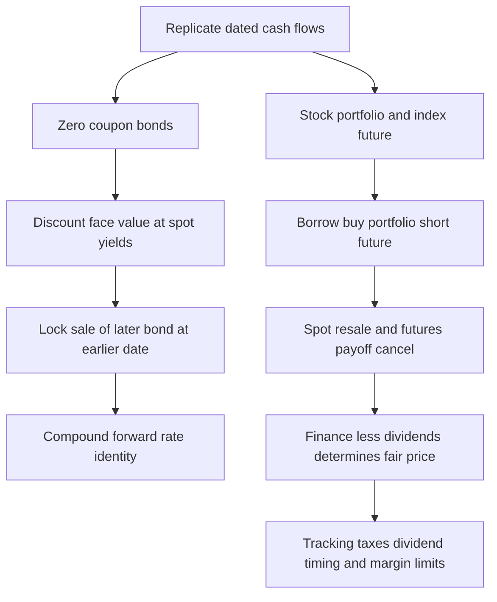

# Derive zero-coupon forward prices and compound forward yields

## Record metadata

```json
{
  "schema_version": 3,
  "owner": "plan",
  "course_id": "2026_2027/Winter_Semester/Financial_Markets_Instruments_I",
  "transaction_id": "PLAN-20261018-FMI-P004",
  "plan_version": "P004",
  "source_version": "V003",
  "ingestion_revision": 3,
  "objective_id": "O018",
  "objective_revision": 1,
  "criterion_version": "O018-C1",
  "status": "ready",
  "lesson_content_contract": "self-contained-lessons-v1",
  "knowledge_components": [
    "dated_zero_coupon_prices_and_replication_quantity",
    "forward_price_and_compound_yield_derivation",
    "cash_cancellation_duration_and_prediction_limits"
  ],
  "prerequisite_ids": [
    "O014"
  ],
  "compatible_versions": [],
  "note_locations": [
    {
      "path": "01_Notes/2026_2027/Winter_Semester/Financial_Markets_Instruments_I/Week_3/Bond_Forward_Rates_and_Stock_Index_Parity.md",
      "heading": "Bond forward rates and stock index parity"
    },
    {
      "path": "01_Notes/2026_2027/Winter_Semester/Financial_Markets_Instruments_I/Week_3/Bond_Forward_Rates_and_Stock_Index_Parity.md",
      "heading": "Zero-coupon prices and dates"
    },
    {
      "path": "01_Notes/2026_2027/Winter_Semester/Financial_Markets_Instruments_I/Week_3/Bond_Forward_Rates_and_Stock_Index_Parity.md",
      "heading": "Deriving the forward-rate identity"
    }
  ],
  "acquisition_rule": {
    "distinct_independent_passes": 2,
    "required_item_roles": [
      "full_capability_check",
      "full_capability_check"
    ],
    "allowed_routes": [
      [
        "O018-I1",
        "O018-I2"
      ],
      [
        "O018-I1",
        "O018-D1"
      ],
      [
        "O018-I1",
        "O018-D2"
      ],
      [
        "O018-I2",
        "O018-D1"
      ],
      [
        "O018-I2",
        "O018-D2"
      ],
      [
        "O018-D1",
        "O018-D2"
      ]
    ]
  },
  "delayed_rule": {
    "minimum_elapsed_hours": 24,
    "fresh_item": true,
    "independent_required": true
  },
  "review_topic": "Derive zero-coupon forward prices and compound forward yields",
  "review_instruction": "Begin a closed-note review with teach for O018; request an unused prepared delayed item before recap."
}
```

## Outcome and conditions

Price comparable zero coupons, construct the issuing/buying/forward package, derive its forward delivery price and adjacent-period compound yield identity without forecasting future spot yields. All essential components listed in metadata are required. Hypothetical assessment values instantiate the checked equations; they are not historical observations or current contract terms. Independent checks are closed-note and without hints, solution access, external retrieval or other assistance; a basic arithmetic calculator is allowed. Teach establishes and records actual help/exposure conditions before claiming independence.

## Prerequisites and checks

- [O014 outcome and repair route](../lessons/O014.md#outcome-and-conditions): zero-investment replication and feasibility must be understood before its financial application.

O018-P1, item_version 1, prerequisite_diagnostic. **Prompt:** A default-free bond pays $121$ in two years at annual effective yield $.10$. Price? Is it $121/(1+.10\times2)$? Separately, if issuing one earlier bond raises $P_1$ and a later bond costs $P_2$, how many later bonds can be bought for zero net opening cash and why must a feasible certain terminal surplus be zero when the package is reversible?

**Complete key and rubric:** $121/(1.10)^2=100$; the simple denominator is a different convention. Buy $q=P_1/P_2$ later bonds, so $P_1-qP_2=0$; no-arbitrage and the feasible reverse rule out either strictly positive or negative certain payoff at fair price. Require the compound distinction and O014 zero-investment/reversibility argument. If absent, use the complete Zero-coupon prices and dates passage in this lesson before W1; O014 supplies the zero-investment replication prerequisite. Pass requires every requested reason and result; partial for an omitted reason or unresolved isolated arithmetic slip; fail for the conflicting mechanism. This diagnostic never counts as acquisition. Current or explicitly compatible committed independent prerequisite evidence may permit skipping its check; familiarity alone cannot. Use the cited complete prerequisite lesson or the named included foundation, then the worked example, after a partial/failing entry check.

## Teaching order and rationale

1. Use the diagnostic once to establish the necessary cash-flow/quotation foundation.
2. Present the complete checked-note explanation below, preserving variables, dates, assumptions and source qualifications. Follow one dated strategy at a time so cancellation is visible.
3. Work W1 fully, asking the learner to explain why each step follows.
4. Use S1 as completion practice: show the setup and first identity, hide the final algebra/numbers and interpretation. After an explanation of the missing steps, withdraw support.
5. Present unused I1/I2 full checks with hidden solutions; use correction/repair after scoring the original answer. An unused D form can replace an exposed I only through a listed route.
6. On a later eligible occasion, begin an unused D item before recap. A numeric variant establishes bounded same-method performance, not general transfer.

## Motivation, intuition, and definitions

Price comparable zero coupons, construct the issuing/buying/forward package, derive its forward delivery price and adjacent-period compound yield identity without forecasting future spot yields. The central question is which dated cash flows cancel and which risk remains. Match quantities and dates before simplifying an equation. The complete reused passages establish every academic claim, notation choice and qualification assessed here; necessary prerequisites use the complete lessons above.

## Explanation steps

Origin: reused complete note introduction before the first subsection, [[01_Notes/2026_2027/Winter_Semester/Financial_Markets_Instruments_I/Week_3/Bond_Forward_Rates_and_Stock_Index_Parity.md#Bond forward rates and stock index parity]], fingerprint `d7ab9842da46a637253eee946ddc40c7fda3e5255580ef0b62c78c83b2ff16d4`.

### Bond forward rates and stock index parity

The same no-arbitrage question prices an investment between two future dates and a stock portfolio delivered later. Bonds require compound discount factors; the stock-index slide returns to the lecture's simple carry convention. Keeping those conventions distinct is necessary to interpret each formula correctly. [[00_Materials/2026_2027/Winter_Semester/Financial_Markets_Instruments_I/Week_3/L12(CostOfCarryModel).pptx|L12(CostOfCarryModel).pptx, physical slide 9–10]]



The source relationships and their limitations are on slides 9–10. [[00_Materials/2026_2027/Winter_Semester/Financial_Markets_Instruments_I/Week_3/L12(CostOfCarryModel).pptx|L12(CostOfCarryModel).pptx, physical slide 9–10]]

Origin: reused complete checked passage [[01_Notes/2026_2027/Winter_Semester/Financial_Markets_Instruments_I/Week_3/Bond_Forward_Rates_and_Stock_Index_Parity.md#Zero-coupon prices and dates]]; fingerprint `d7ab9842da46a637253eee946ddc40c7fda3e5255580ef0b62c78c83b2ff16d4`. Heading depth alone is adapted.

### Zero-coupon prices and dates

A zero-coupon bond pays only face value $M$ at maturity. Let $T_1<T_2$ be maturities in years and $r_{T_1},r_{T_2}$ the respective annual effective spot yields. Then

$$P_{T_1}=\frac{M}{(1+r_{T_1})^{T_1}},\qquad
P_{T_2}=\frac{M}{(1+r_{T_2})^{T_2}}.$$

These are compound-price definitions for the stated yields, not the simple-interest model from the currency slide. Let $F_{T_2}^{T_1}$ be today's agreed price for delivery of the later bond at $T_1$, and $f_{T_1,T_2}$ the annualized forward yield over $[T_1,T_2]$. At the earlier date the later bond has $T_2-T_1$ years remaining, so

$$F_{T_2}^{T_1}=\frac{M}{(1+f_{T_1,T_2})^{T_2-T_1}}.$$

The forward rate is contracted/implied today. It is distinct from the as-yet-unknown spot yield that may prevail at $T_1$. Treat the bonds as otherwise comparable and free of default risk in this idealized replication. [[00_Materials/2026_2027/Winter_Semester/Financial_Markets_Instruments_I/Week_3/L12(CostOfCarryModel).pptx|L12(CostOfCarryModel).pptx, physical slide 9]]


Origin: reused complete checked passage [[01_Notes/2026_2027/Winter_Semester/Financial_Markets_Instruments_I/Week_3/Bond_Forward_Rates_and_Stock_Index_Parity.md#Deriving the forward-rate identity]]; fingerprint `d7ab9842da46a637253eee946ddc40c7fda3e5255580ef0b62c78c83b2ff16d4`. Heading depth alone is adapted.

### Deriving the forward-rate identity

Today issue one earlier bond, receiving $P_{T_1}$ and committing to repay $M$ at $T_1$. Spend those proceeds on $q=P_{T_1}/P_{T_2}$ units of the later bond, and sell those units forward for delivery at $T_1$. Opening net investment is zero. At $T_1$ receive $qF_{T_2}^{T_1}$ under the forward and repay $M$. No arbitrage gives

$$qF_{T_2}^{T_1}=M,\qquad
F_{T_2}^{T_1}=M\frac{P_{T_2}}{P_{T_1}}.$$

Insert the price formulas and cancel $M$:

$$\frac{M}{(1+f_{T_1,T_2})^{T_2-T_1}}
=M\frac{(1+r_{T_1})^{T_1}}{(1+r_{T_2})^{T_2}},$$

$$\boxed{(1+r_{T_2})^{T_2}=(1+r_{T_1})^{T_1}(1+f_{T_1,T_2})^{T_2-T_1}}.$$

The left side is growth over the full $T_2$ years. The right side grows first to $T_1$, then across the remaining interval at a rate locked today. Consequently

$$f_{T_1,T_2}=\left[\frac{(1+r_{T_2})^{T_2}}{(1+r_{T_1})^{T_1}}\right]^{1/(T_2-T_1)}-1.$$

This multiplication of growth factors is why merely subtracting spot yields does not compute the forward rate. It also explains the prerequisite: understand discounting and match dates before using a yield curve. No claim that the implied forward rate predicts the actual future rate follows from the replication. [[00_Materials/2026_2027/Winter_Semester/Financial_Markets_Instruments_I/Week_3/L12(CostOfCarryModel).pptx|L12(CostOfCarryModel).pptx, physical slide 9]]

![[01_Notes/2026_2027/Winter_Semester/Financial_Markets_Instruments_I/assets/Week_3_L12_Zero_Coupon_Parity.png]]

The source's timeline ends at the earlier maturity, because the later bond is sold forward then; there is no need to wait for its final face-value payment to settle this package. [[00_Materials/2026_2027/Winter_Semester/Financial_Markets_Instruments_I/Week_3/L12(CostOfCarryModel).pptx|L12(CostOfCarryModel).pptx, physical slide 9]]


## Worked example

O018-W1, item_version 1, worked_example. **Prompt:** Comparable default-free zero-coupon bonds each pay face $M=100$, at $T_1=1$ and $T_2=2$ years. Annual effective spot yields are $r_{T_1}=0.04$ and $r_{T_2}=0.05$. Matching issue/purchase/forward transactions are possible. Compute both cash prices. Construct a zero-net-opening-investment package issuing one earlier bond and buying/selling forward the correct number of later bonds for delivery at $T_1$. Derive the forward delivery price and the annual effective forward yield; show cash cancellation at both dates. Explain why subtracting spot yields, using the full $T_2$ as forward duration, or interpreting the forward yield as a guaranteed future spot yield is invalid.

**Complete solution and essential rubric:** $P_{T_1}=M/(1+r_{T_1})^{T_1}=96.15384615$ and $P_{T_2}=M/(1+r_{T_2})^{T_2}=90.70294785$. Issue one earlier bond for $P_{T_1}$, buy $q=P_{T_1}/P_{T_2}=1.06009615$ later bonds and short $q$ matching forwards. Opening cash $P_{T_1}-qP_{T_2}=0$. At $T_1$ deliver those later bonds and receive $qF_{T_2}^{T_1}$, repaying face $M$. Zero profit gives $qF=M$ and $F=M P_{T_2}/P_{T_1}=94.33106576$. With remaining life $T_2-T_1=1$, $F=M/(1+f_{T_1,T_2})^{T_2-T_1}$. Substituting produces $(1+r_{T_2})^{T_2}=(1+r_{T_1})^{T_1}(1+f_{T_1,T_2})^{T_2-T_1}$ and $f_{T_1,T_2}=[(1+r_{T_2})^{T_2}/(1+r_{T_1})^{T_1}]^{1/(T_2-T_1)}-1=0.06009615$ annually. The package ends at $T_1$ when the later bonds are sold; no double-counted face at $T_2$ remains. Compound factors multiply across adjacent periods, so a yield difference or wrong duration does not replicate them. The rate is implied/locked today, with no guarantee about the future spot yield. Compatible default risk, funding/shorting and value dates are model assumptions. All requested calculations, derivations and qualifications are essential; the component map above applies to every full form.

## Practice with fading assistance

O018-S1, item_version 1, supported_completion. **Prompt:** Comparable default-free zero-coupon bonds each pay face $M=100$, at $T_1=1$ and $T_2=3$ years. Annual effective spot yields are $r_{T_1}=0.03$ and $r_{T_2}=0.045$. Matching issue/purchase/forward transactions are possible. Compute both cash prices. Construct a zero-net-opening-investment package issuing one earlier bond and buying/selling forward the correct number of later bonds for delivery at $T_1$. Derive the forward delivery price and the annual effective forward yield; show cash cancellation at both dates. Explain why subtracting spot yields, using the full $T_2$ as forward duration, or interpreting the forward yield as a guaranteed future spot yield is invalid.

**Complete solution and essential rubric:** $P_{T_1}=M/(1+r_{T_1})^{T_1}=97.08737864$ and $P_{T_2}=M/(1+r_{T_2})^{T_2}=87.62966041$. Issue one earlier bond for $P_{T_1}$, buy $q=P_{T_1}/P_{T_2}=1.10792828$ later bonds and short $q$ matching forwards. Opening cash $P_{T_1}-qP_{T_2}=0$. At $T_1$ deliver those later bonds and receive $qF_{T_2}^{T_1}$, repaying face $M$. Zero profit gives $qF=M$ and $F=M P_{T_2}/P_{T_1}=90.25855022$. With remaining life $T_2-T_1=2$, $F=M/(1+f_{T_1,T_2})^{T_2-T_1}$. Substituting produces $(1+r_{T_2})^{T_2}=(1+r_{T_1})^{T_1}(1+f_{T_1,T_2})^{T_2-T_1}$ and $f_{T_1,T_2}=[(1+r_{T_2})^{T_2}/(1+r_{T_1})^{T_1}]^{1/(T_2-T_1)}-1=0.05258172$ annually. The package ends at $T_1$ when the later bonds are sold; no double-counted face at $T_2$ remains. Compound factors multiply across adjacent periods, so a yield difference or wrong duration does not replicate them. The rate is implied/locked today, with no guarantee about the future spot yield. Compatible default risk, funding/shorting and value dates are model assumptions. All requested calculations, derivations and qualifications are essential; the component map above applies to every full form.

Allowed support is the first cash-flow identity only; hide the remaining key while the learner completes it. Supported performance is practice, not an independent result.

## Rubric and independence

Required components: dated_zero_coupon_prices_and_replication_quantity, forward_price_and_compound_yield_derivation, cash_cancellation_duration_and_prediction_limits. Each full prompt/key below elicits every component; all are necessary for a pass on every permitted pair. Accept algebraically equivalent expressions and clearly defined opposite cash-flow signs with correct interpretation. A pass requires all requested outputs/reasons, correct units/assumptions and no critical conceptual error. Partial means a missing component or an unresolved isolated arithmetic slip with an otherwise valid method; independent correction is required for a pass. Fail means a critical mechanism/condition is wrong. Unscorable means a response or its help/exposure conditions cannot be established. Unknown help conditions are never independent evidence.

Critical errors: Subtracting yields; wrong remaining duration; double-counting later face after selling the bond; mixing simple and compound conventions; forward yield asserted as a guaranteed future spot yield.

Acquisition requires two distinct unused unassisted full checks selected from the six exact metadata routes. Every I/D form covers all components; W1, S1, the prerequisite and C1 are forbidden substitutes. A D form used for acquisition cannot later be counted again as delayed success. No teach-generated item may replace a named full check; additional verified explanation/practice is allowed under the unchanged method and may not fabricate evidence. If fewer than two fresh forms remain for acquisition, return a plan_issue for an additional prepared bank.

| Component | I1 | I2 | D1 | D2 |
|---|---|---|---|---|
| dated_zero_coupon_prices_and_replication_quantity | required | required | required | required |
| forward_price_and_compound_yield_derivation | required | required | required | required |
| cash_cancellation_duration_and_prediction_limits | required | required | required | required |

## Misconceptions and correction

An observed omitted term/sign is tentative until the learner explains it; compare the reasoning with the critical errors above. Score the original response before providing help. Route a conceptual failure to the relevant included derivation and prerequisite, then use an unused full form.

O018-C1, item_version 1, narrow_correction. **Prompt:** A cash-flow derivation has replaced an uncertain terminal price by its expectation and then calls its realized payoff guaranteed. Is the inference justified, and what must a riskless replication establish instead? **Key/rubric:** No: an expectation is not a realized amount. Matching feasible dated inflows/outflows must cancel uncertain states or contract the necessary conversions. Pass requires the distinction and matching condition; partial for missing one, fail for equating expectation with certainty. This repairs a common inference only; it cannot substitute for a full numerical/capability check.

Give at most two hints (first identify the date/unit, second point to the included identity); after ineffective hints show the relevant worked step. After two unsuccessful independent attempts stop repeated quizzing, revisit the explanation/prerequisite and preserve the unresolved status.

## Immediate and delayed checks

### O018-I1

O018-I1, item_version 1, full_capability_check. **Prompt:** Comparable default-free zero-coupon bonds each pay face $M=1000$, at $T_1=2$ and $T_2=3$ years. Annual effective spot yields are $r_{T_1}=0.025$ and $r_{T_2}=0.04$. Matching issue/purchase/forward transactions are possible. Compute both cash prices. Construct a zero-net-opening-investment package issuing one earlier bond and buying/selling forward the correct number of later bonds for delivery at $T_1$. Derive the forward delivery price and the annual effective forward yield; show cash cancellation at both dates. Explain why subtracting spot yields, using the full $T_2$ as forward duration, or interpreting the forward yield as a guaranteed future spot yield is invalid.

**Complete solution and essential rubric:** $P_{T_1}=M/(1+r_{T_1})^{T_1}=951.81439619$ and $P_{T_2}=M/(1+r_{T_2})^{T_2}=888.99635867$. Issue one earlier bond for $P_{T_1}$, buy $q=P_{T_1}/P_{T_2}=1.07066175$ later bonds and short $q$ matching forwards. Opening cash $P_{T_1}-qP_{T_2}=0$. At $T_1$ deliver those later bonds and receive $qF_{T_2}^{T_1}$, repaying face $M$. Zero profit gives $qF=M$ and $F=M P_{T_2}/P_{T_1}=934.00179933$. With remaining life $T_2-T_1=1$, $F=M/(1+f_{T_1,T_2})^{T_2-T_1}$. Substituting produces $(1+r_{T_2})^{T_2}=(1+r_{T_1})^{T_1}(1+f_{T_1,T_2})^{T_2-T_1}$ and $f_{T_1,T_2}=[(1+r_{T_2})^{T_2}/(1+r_{T_1})^{T_1}]^{1/(T_2-T_1)}-1=0.07066175$ annually. The package ends at $T_1$ when the later bonds are sold; no double-counted face at $T_2$ remains. Compound factors multiply across adjacent periods, so a yield difference or wrong duration does not replicate them. The rate is implied/locked today, with no guarantee about the future spot yield. Compatible default risk, funding/shorting and value dates are model assumptions. All requested calculations, derivations and qualifications are essential; the component map above applies to every full form.

I1/I2 are immediate checks; D1/D2 are distinct parallel variants reserved where possible for delayed checks. A delayed success requires an unused form before recap, no help/solution access, and at least 24 actual elapsed hours after acquisition and the most recent relevant teaching/solution exposure. Record intervening exposure. A calendar-date change alone is insufficient; an early D attempt is immediate evidence only.

### O018-I2

O018-I2, item_version 1, full_capability_check. **Prompt:** Comparable default-free zero-coupon bonds each pay face $M=100$, at $T_1=1$ and $T_2=2$ years. Annual effective spot yields are $r_{T_1}=0.05$ and $r_{T_2}=0.055$. Matching issue/purchase/forward transactions are possible. Compute both cash prices. Construct a zero-net-opening-investment package issuing one earlier bond and buying/selling forward the correct number of later bonds for delivery at $T_1$. Derive the forward delivery price and the annual effective forward yield; show cash cancellation at both dates. Explain why subtracting spot yields, using the full $T_2$ as forward duration, or interpreting the forward yield as a guaranteed future spot yield is invalid.

**Complete solution and essential rubric:** $P_{T_1}=M/(1+r_{T_1})^{T_1}=95.23809524$ and $P_{T_2}=M/(1+r_{T_2})^{T_2}=89.84524157$. Issue one earlier bond for $P_{T_1}$, buy $q=P_{T_1}/P_{T_2}=1.06002381$ later bonds and short $q$ matching forwards. Opening cash $P_{T_1}-qP_{T_2}=0$. At $T_1$ deliver those later bonds and receive $qF_{T_2}^{T_1}$, repaying face $M$. Zero profit gives $qF=M$ and $F=M P_{T_2}/P_{T_1}=94.33750365$. With remaining life $T_2-T_1=1$, $F=M/(1+f_{T_1,T_2})^{T_2-T_1}$. Substituting produces $(1+r_{T_2})^{T_2}=(1+r_{T_1})^{T_1}(1+f_{T_1,T_2})^{T_2-T_1}$ and $f_{T_1,T_2}=[(1+r_{T_2})^{T_2}/(1+r_{T_1})^{T_1}]^{1/(T_2-T_1)}-1=0.06002381$ annually. The package ends at $T_1$ when the later bonds are sold; no double-counted face at $T_2$ remains. Compound factors multiply across adjacent periods, so a yield difference or wrong duration does not replicate them. The rate is implied/locked today, with no guarantee about the future spot yield. Compatible default risk, funding/shorting and value dates are model assumptions. All requested calculations, derivations and qualifications are essential; the component map above applies to every full form.

### O018-D1

O018-D1, item_version 1, full_capability_check. **Prompt:** Comparable default-free zero-coupon bonds each pay face $M=1000$, at $T_1=2$ and $T_2=4$ years. Annual effective spot yields are $r_{T_1}=0.035$ and $r_{T_2}=0.05$. Matching issue/purchase/forward transactions are possible. Compute both cash prices. Construct a zero-net-opening-investment package issuing one earlier bond and buying/selling forward the correct number of later bonds for delivery at $T_1$. Derive the forward delivery price and the annual effective forward yield; show cash cancellation at both dates. Explain why subtracting spot yields, using the full $T_2$ as forward duration, or interpreting the forward yield as a guaranteed future spot yield is invalid.

**Complete solution and essential rubric:** $P_{T_1}=M/(1+r_{T_1})^{T_1}=933.51070037$ and $P_{T_2}=M/(1+r_{T_2})^{T_2}=822.70247479$. Issue one earlier bond for $P_{T_1}$, buy $q=P_{T_1}/P_{T_2}=1.13468809$ later bonds and short $q$ matching forwards. Opening cash $P_{T_1}-qP_{T_2}=0$. At $T_1$ deliver those later bonds and receive $qF_{T_2}^{T_1}$, repaying face $M$. Zero profit gives $qF=M$ and $F=M P_{T_2}/P_{T_1}=881.29945856$. With remaining life $T_2-T_1=2$, $F=M/(1+f_{T_1,T_2})^{T_2-T_1}$. Substituting produces $(1+r_{T_2})^{T_2}=(1+r_{T_1})^{T_1}(1+f_{T_1,T_2})^{T_2-T_1}$ and $f_{T_1,T_2}=[(1+r_{T_2})^{T_2}/(1+r_{T_1})^{T_1}]^{1/(T_2-T_1)}-1=0.06521739$ annually. The package ends at $T_1$ when the later bonds are sold; no double-counted face at $T_2$ remains. Compound factors multiply across adjacent periods, so a yield difference or wrong duration does not replicate them. The rate is implied/locked today, with no guarantee about the future spot yield. Compatible default risk, funding/shorting and value dates are model assumptions. All requested calculations, derivations and qualifications are essential; the component map above applies to every full form.

### O018-D2

O018-D2, item_version 1, full_capability_check. **Prompt:** Comparable default-free zero-coupon bonds each pay face $M=100$, at $T_1=1$ and $T_2=3$ years. Annual effective spot yields are $r_{T_1}=0.06$ and $r_{T_2}=0.04$. Matching issue/purchase/forward transactions are possible. Compute both cash prices. Construct a zero-net-opening-investment package issuing one earlier bond and buying/selling forward the correct number of later bonds for delivery at $T_1$. Derive the forward delivery price and the annual effective forward yield; show cash cancellation at both dates. Explain why subtracting spot yields, using the full $T_2$ as forward duration, or interpreting the forward yield as a guaranteed future spot yield is invalid.

**Complete solution and essential rubric:** $P_{T_1}=M/(1+r_{T_1})^{T_1}=94.33962264$ and $P_{T_2}=M/(1+r_{T_2})^{T_2}=88.89963587$. Issue one earlier bond for $P_{T_1}$, buy $q=P_{T_1}/P_{T_2}=1.06119245$ later bonds and short $q$ matching forwards. Opening cash $P_{T_1}-qP_{T_2}=0$. At $T_1$ deliver those later bonds and receive $qF_{T_2}^{T_1}$, repaying face $M$. Zero profit gives $qF=M$ and $F=M P_{T_2}/P_{T_1}=94.23361402$. With remaining life $T_2-T_1=2$, $F=M/(1+f_{T_1,T_2})^{T_2-T_1}$. Substituting produces $(1+r_{T_2})^{T_2}=(1+r_{T_1})^{T_1}(1+f_{T_1,T_2})^{T_2-T_1}$ and $f_{T_1,T_2}=[(1+r_{T_2})^{T_2}/(1+r_{T_1})^{T_1}]^{1/(T_2-T_1)}-1=0.03014196$ annually. The package ends at $T_1$ when the later bonds are sold; no double-counted face at $T_2$ remains. Compound factors multiply across adjacent periods, so a yield difference or wrong duration does not replicate them. The rate is implied/locked today, with no guarantee about the future spot yield. Compatible default risk, funding/shorting and value dates are model assumptions. All requested calculations, derivations and qualifications are essential; the component map above applies to every full form.

## Advance, revisit, pause, and escalate

Advance only after teach commits two qualifying independent full passes under a listed route. Keep acquisition and each later delayed observation separate. A source conflict blocks the affected claim and returns to ingest with the exact note heading. Missing criteria, a new method, unsupported alternative or exhausted fresh bank returns to plan with 2026_2027/Winter_Semester/Financial_Markets_Instruments_I, O018, revision1/O018-C1, P004/V003/ingestion3 and item ID. Equivalent valid methods meeting the frozen criterion may receive credit after verification; no criterion is changed to fit an answer. Closing a session preserves the actual stopping point without claiming completion.

## Content provenance and generation boundaries

Explanations, figures and qualifications above reuse complete checked-note sections with exact origin/fingerprint; heading depth alone is adapted. Main exercises and worked arithmetic are plan-created hypothetical instantiations of those displayed identities. No additional academic claims or external course scope are introduced. Preserve simple/compound conventions explicitly. Supplemental NDF/peg and implementation qualifications originate in the checked notes and their cited verified references, not an independent raw-source audit by plan. New numerical practice can use the same method only after its complete solution and unchanged components are checked before display; it cannot replace this lesson’s named evidence forms. Prerequisites route to the complete prepared lessons above.

## Answer-free recall handoff

Topic: Derive zero-coupon forward prices and compound forward yields. Begin a closed-note review with teach for O018; request an unused prepared delayed item before recap. Exact lesson: [[03_Agents/2026_2027/Winter_Semester/Financial_Markets_Instruments_I/lessons/O018.md#Immediate and delayed checks]]. Teach supplies actual committed evidence and timestamps; recall alone dates reviews. No learner outcome or due date is created by this curriculum.
