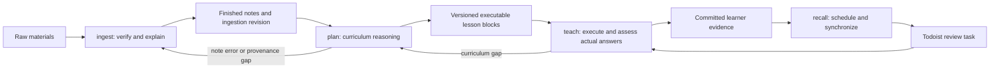

# University Assistant — master plugin architecture

## Contents

| Section | GitHub | Obsidian |
|---|---|---|
| **1. Authority and overview** | [Jump](#1-authority-and-overview) | [Jump](#1.%20Authority%20and%20overview) |
| Authority and current component map | [Jump](#authority-and-current-component-map) | [Jump](#Authority%20and%20current%20component%20map) |
| **2. Current workflow and ownership** | [Jump](#2-current-workflow-and-ownership) | [Jump](#2.%20Current%20workflow%20and%20ownership) |
| Self-contained lessons and reuse | [Jump](#self-contained-lessons-and-reuse) | [Jump](#Self-contained%20lessons%20and%20reuse) |
| Model roles and execution | [Jump](#model-roles-and-execution) | [Jump](#Model%20roles%20and%20execution) |
| Existing skill responsibility and ownership matrix | [Jump](#existing-skill-responsibility-and-ownership-matrix) | [Jump](#Existing%20skill%20responsibility%20and%20ownership%20matrix) |
| Responsibility and artifact matrix | [Jump](#responsibility-and-artifact-matrix) | [Jump](#Responsibility%20and%20artifact%20matrix) |
| **3. Freshness, versions and history** | [Jump](#3-freshness-versions-and-history) | [Jump](#3.%20Freshness%2C%20versions%20and%20history) |
| Freshness, versions, and history | [Jump](#freshness-versions-and-history) | [Jump](#Freshness%2C%20versions%2C%20and%20history) |
| **4. Writes and recovery** | [Jump](#4-writes-and-recovery) | [Jump](#4.%20Writes%20and%20recovery) |
| Safe writes and interruption recovery | [Jump](#safe-writes-and-interruption-recovery) | [Jump](#Safe%20writes%20and%20interruption%20recovery) |
| **5. Handoffs and validation** | [Jump](#5-handoffs-and-validation) | [Jump](#5.%20Handoffs%20and%20validation) |
| Handoffs | [Jump](#handoffs) | [Jump](#Handoffs) |
| Current checks and review points | [Jump](#current-checks-and-review-points) | [Jump](#Current%20checks%20and%20review%20points) |
| **6. Dated runtime snapshot** | [Jump](#6-dated-runtime-snapshot) | [Jump](#6.%20Dated%20runtime%20snapshot) |
| Inspected runtime state and limits | [Jump](#inspected-runtime-state-and-limits) | [Jump](#Inspected%20runtime%20state%20and%20limits) |
| **7. Methods and scheduling** | [Jump](#7-methods-and-scheduling) | [Jump](#7.%20Methods%20and%20scheduling) |
| Methods and scheduling | [Jump](#methods-and-scheduling) | [Jump](#Methods%20and%20scheduling) |
| **8. Packaging** | [Jump](#8-packaging) | [Jump](#8.%20Packaging) |
| Source and generated packaging | [Jump](#source-and-generated-packaging) | [Jump](#Source%20and%20generated%20packaging) |

## 1. Authority and overview

Canonical master overview, inspected 2026-10-17. This document owns cross-skill boundaries and storage; the maintained skill bodies own execution details. Historical reviews describe earlier designs, never current instructions.

Primary vault: `/Users/slavomirhoricka/Desktop/University_notes`. For an isolated task, its actual selected checkout is the vault root, as required by root `AGENTS.md`. All maintained skill bodies resolve workflow paths against that selected checkout. Older historical records may retain `/Users/slavomirhoricka/Desktop/Obsidian/Uni` as provenance; it is not a current write destination. The scoped path and Week2 recovery is recorded in [[03_Agents/runtime/sessions/2026-10-09-uni-paths-week2-recovery]].

Private release and host activation are distinguished in [[03_Agents/plugins/uni-teach-release.json]].

### Authority and current component map

University Assistant is the private plugin with identity `uni-teach`. Inspection of the maintained folders, packaging utility and generated plugin manifest establishes **four core workflow skills**: [[03_Agents/ingest/SKILL|ingest]], [[03_Agents/plan/SKILL|plan]], [[03_Agents/teach/SKILL|teach]] and [[03_Agents/recall/SKILL|recall]]. The fifth public skill, [[03_Agents/html-course/SKILL|html-course]], is an optional read-only curriculum consumer and offline export owner. Templates, references, scripts, legacy template redirects and validation examples are supporting components, not additional skills.

This file is the appropriate master location because it already defines shared ownership, handoffs, freshness and storage and is linked by [[03_Agents/README]] and the vault README. Keep this single canonical overview; generated copies do not become maintenance authority.

| Component / location | Current responsibility and authority |
|---|---|
| `00_Materials/<course_id>/` | User-owned original sources; ingest reads the authorized scope. |
| `01_Notes/<course_id>/` | Ingest-owned finished explanations, hubs and source assets; the academic input to plan. |
| `03_Agents/{ingest,plan,teach,recall,html-course}/` | Sole maintained skill instructions, owned templates, references and utilities. |
| `03_Agents/<course_id>/` | Separate ingestion, curriculum, evidence and scheduling records, with one owner per artifact. |
| `03_Agents/runtime/ingest/` | Ingest-owned vault index and per-pass coverage/check records. |
| `03_Agents/runtime/recall/` | Recall-owned verified Todoist project mappings and their transactions. |
| `03_Agents/scripts/records.py` | Shared owner-enforcing locks, expected-byte checks, atomic replacements and recoverable journals. It does not grade or verify academic claims. |
| `03_Agents/references/LEARNING_METHODS.md` | Methodology evidence and limitations; not course content or learner evidence. |
| `03_Agents/scripts/sync_plugin.py`, `plugins/uni-teach/` | Packaging utility and generated distribution, including a copy of this architecture. Account release receipt and installed caches are separate deployment evidence. |
| `03_Agents/runtime/sessions/`, `history/`, `validation/` | Engineering handoffs, preserved history and fictional rehearsals; never learner progress or course readiness. |
| Todoist connector | External task service used only by recall; not a learning authority. No background watcher is configured by the skills. |

The following map describes the existing workflow.

## 2. Current workflow and ownership

### Self-contained lessons and reuse

The maintained `03_Agents/references/LESSON_CONTENT.md` contract defines the 2026-10-17 boundaries. Ingest keeps producing complete checked notes. Plan reuses their full relevant explanations, derivations, figures and examples inside self-contained lessons, orders them and designs the main exercises/solutions/criteria. It may add verified teaching explanations without editing notes.

Teach delivers those lessons with adaptive pacing, questions/tangents, bounded prechecked generated items and valid alternative-method assessment under unchanged standards. New item contracts persist before prompts in the teach log; old definitions/evidence remain immutable. Completed ingestion triggers sequential plan reconciliation unless explicitly limited; existing curricula adopt the contract at their next substantive revision.

Independent curriculum review includes lesson additions and their cited authoritative support.

### Model roles and execution

[[03_Agents/references/MODEL_ROUTING|Model routing policy]] defines the seven role defaults, escalation, capability fallback, one-writer authority and interactive learner relay. Canonical custom-agent TOML files live in `03_Agents/agents/`; the synchronizer generates project `.codex/agents/` and packaged `agents/` copies. These internal roles keep the four core skills' existing routing; html-course adds no role profile. Host dispatch selects subagent models; a skill cannot change the running chat model or automatically install global configuration.

Ingest uses deterministic extraction, Sol scope/structure, bounded Luna drafts and Sol/Astra difficult reasoning, then owner integration and independent Astra review of full originals. Repairs receive renewed checking before publication. Plan prepares from finished notes and obtains an independent Astra curriculum review before readiness.

Teach keeps a Luna owner across turns and uses a read-only Sol assessor for demanding prepared-rubric responses; teach remains evidence owner. Recall uses Luna with the deterministic scheduler and its existing outbox/ownership gates. Requested and actual host-confirmed model settings remain distinct; no benchmarked quality/cost improvement is claimed.

### Optional HTML course export

Explicit HTML generation consumes matching committed ingestion/plan tuples, ready objectives and selected checked note sections. It requires complete English explanations, source/section coverage mapping, independent final conversion review and browser checks. Plain ingestion and the four core skills remain unchanged. A partial overall curriculum may provide a genuinely ready bounded export; exam completeness is not a gate.

The export owner writes only `02_Resources/HTML_Courses/<course_id>/`: immutable versions, build/coverage metadata, review records and an atomically activated root contents page. It checks input freshness again, refuses external edits and preserves earlier versions, unfinished stages and locks. It does not extend the four-owner course-record schema or write notes, plans, logs, recall state or Todoist.

HTML is double-clickable, with local fonts/scripts/assets, LaTeX, week/lesson navigation and unrestricted solution reveals. Browser-local position/answers are convenience data, not independent performance or learner evidence. Exposing a prepared item may affect its later freshness for chat assessment; no exposure event is fabricated. Later explicit builds inspect changed inputs and reconcile the existing exported scope. No watcher, tutor integration, app or server is installed.

### Existing skill responsibility and ownership matrix

Read permissions are scoped to the resolved course and requested work. Each row summarizes the maintained skill's actual contract; it grants no extra writes. Shared transaction journals and lock metadata support each owner's writes without transferring ownership of the underlying record.

#### ingest

**ingest** — inspect new/changed or adopted source material and establish checked, self-contained teaching notes

**Inputs and permitted reads**

Exact user-supplied folder including nested files, or explicitly named existing-note repair passages and their cited originals; bounded verification context; existing notes/assets/hubs; ingestion index, linked passes and state; navigation guidance. May consult bounded academic references for verification/foundations and records their actual contribution.

**Owned data and permitted changes**

Course notes, hubs and assets in `01_Notes`; runtime ingestion index and pass records; course `ingestion_state.json`, revisions, checked hashes/headings and unresolved gaps. Originals remain user-owned, read-only unless relocation was expressly authorized.

**Outputs and handoff points**

Finished notes plus independent source review, coverage ledger, conceptual priorities and prerequisite reasons; completion/run/revision, exact locators and gaps to **plan**. Interrupted coverage stays discoverable and incomplete; existing note replacement conflicts follow ingest's approval rule.

**Work it must not take over**

No lesson objectives, executable sequence, rubrics, criterion compatibility, curriculum archives, learner outcomes, recall dates or Todoist tasks. Its conceptual reading path is input to plan, not curriculum design.

#### plan

**plan** — turn finished, checked notes into executable, versioned curriculum

**Inputs and permitted reads**

Selected finished notes and necessary dependencies/assets; complete ingestion state and linked successful passes; existing plan/manifest/lessons/history; relevant committed learner events for gaps/version context; recall state only for requested timing constraints; explicit goals/scope/tools/deadline.

**Owned data and permitted changes**

`learning_plan.md`, `source_manifest.md`, `lessons/<objective_id>.md`, immutable `curriculum_history/<plan_version>/`. Owns objectives, dependencies, sequence, prepared explanations/examples/tasks/keys/rubrics, acquisition/delayed conditions, compatibility and reassessment definitions; fingerprints finished-note inputs.

**Outputs and handoff points**

Matching committed bundle and ready/partial/blocked scope to **teach**; exact academic/provenance gaps to **ingest**; changed objective/version mappings, reassessment gates and answer-free review labels to **recall**, without due dates.

**Work it must not take over**

No original-course-source audit or note repair; verified lesson supplements follow the lesson-content contract; no live teaching/grading, learning-log initialization, learner-status changes, regrading old answers, recall-state writes or task synchronization.

#### teach

**teach** — run/resume prepared lessons, practise/review, assess actual answers

**Inputs and permitted reads**

Matching committed ingestion and plan metadata; only indexed lesson blocks and cited finished-note sections/dependencies; committed learning events/session state; historical definitions when interpreting old evidence; recall review identity and reason. A narrow factual answer from a finished note may be given without objective records; structured study needs a ready executable plan.

**Owned data and permitted changes**

Only course `learning_log.md`: observed presentations, responses/results, help/feedback/exposure, supported acquisition/reassessment events, issues, append-only corrections and derived session/evidence summaries.

**Outputs and handoff points**

Checkpointed attempts and actual version-qualified evidence; committed event IDs, times, assistance/exposure and gates to **recall**; precise missing prepared rules/variants to **plan**; note contradictions or explicit freshness warnings to **ingest**.

**Work it must not take over**

No curriculum/criterion redefinition, original-course-source re-audit, note/manifest repair, academic-note hashing, review-date arithmetic or Todoist. Bounded prechecked generated items, responsive explanations and valid alternative-method assessment follow the lesson-content contract.

#### recall

**recall** — derive due reviews from committed evidence and synchronize verified course tasks

**Inputs and permitted reads**

Requested course/objectives or existing recall states for a vault-wide due queue; targeted plan/lesson/manifest/ingestion metadata and committed teach events; current scheduling state; verified existing Todoist projects and positively owned task inventories. Checks event reference/commit/version integrity, not answers.

**Owned data and permitted changes**

Course `recall_state.json`: evidence cursor, intended schedules, policy/version gates, deferrals/suppression, outbox, task IDs and append-only schedule/task/sync history. Runtime `project_map.json`: factual verified project mapping. External mutations only to positively identified recall-owned tasks under its synchronization contract.

**Outputs and handoff points**

Due/overdue/reassessment identities to **teach**; committed intended dates and separately connector-confirmed tasks; held conflicts/retry state when synchronization is uncertain; readiness/criterion gaps to **plan**, unfinished ingestion/academic issues to **ingest** through the appropriate handoff.

**Work it must not take over**

No teaching, grading, inferred mastery/acquisition, academic audits, note/plan/log writes, regrading, guessed project creation or treating task completion/missed dates/confidence as learning. No automatic watcher or notification service.

The detailed artifact matrix below makes file-level ownership explicit. Maintenance of this overview is separate from executing any learning skill.

### Responsibility and artifact matrix

Shared reading never grants write ownership. Maintenance of infrastructure is an explicitly authorized maintenance task, separate from ordinary learning workflows.

| Action / authoritative artifact | Sole owner | Permitted readers / rules |
|---|---|---|
| Inspect raw academic materials; verify claims/equations/visuals; independent academic fact checking | ingest | Others may navigate identities but may not re-audit raw content |
| Notes, hubs, assets in `01_Notes/<course_id>/` | ingest | plan, teach; recall may reference titles/anchors without content audit |
| Raw materials in `00_Materials/` | User | ingest read-only; moves require explicit relocation authorization |
| `runtime/ingest/ingestion_log.md`, `runtime/ingest/logs/<run_id>.md` | ingest | plan reads completion/coverage; detail is completion authority, index navigation |
| Course `ingestion_state.json`: completion, freshness revision, checked hashes | ingest | plan reads/checks; teach/recall compare tokens only |
| Course `learning_plan.md`, `source_manifest.md`, `lessons/<objective_id>.md` | plan | teach/recall read; no learner outcomes or next-review dates |
| Course `curriculum_history/<plan_version>/`: prior plan, manifest, blocks, objective/criterion definitions | plan | immutable after publication; preserves interpretation of evidence |
| Objectives, dependencies, sequence, explanations, examples, keys, rubrics, correction tasks, delayed bank, compatibility/reassessment mappings | plan | teach follows prepared routes with bounded generated items under unchanged criteria; no curriculum redefinition |
| Present/adapt explanation; choose prepared question; assess actual response with prepared rubric | teach | bounded verified additions and generated items under the lesson-content contract; no changed objectives/criteria |
| Course `learning_log.md`: presentations, results, assistance/exposure, acquisitions, issues, corrections, session state | teach | plan reads gaps, recall reads committed outcomes |
| Course `recall_state.json`: cursor, interval/due state, project mapping, outbox, task IDs, sync state, explicit deferrals | recall | teach may read review identity; no grade/outcome fields |
| `runtime/recall/project_map.json`: verified existing project IDs keyed by full vault course identity | recall | factual mappings only, no learner outcomes or invented schedules |
| Todoist recall task creation/update/reopen/supersession/sync | recall | positively identified recall-owned tasks only; completion is task state |
| Conduct due/reassessment review and record actual answer | teach | recall provides identities and due context; never teaches/grades |
| Navigation, naming, architecture, methodology, templates/utilities, package and release manifests | Authorized maintenance | ordinary skills report maintenance issues rather than rewriting infrastructure |
| `validation/` sample plans/rehearsals | Authorized maintenance | explicitly non-runtime; never real learner evidence |
| `history/` migration maps, baselines, snapshots, release ZIPs | Authorized maintenance | excluded from ordinary skill discovery/live link disambiguation |

Paths are relative to `03_Agents/` unless beginning `00_Materials` or `01_Notes`. `course_id` is exact `<academic_year>/<semester>/<course_folder>`. Preserve language, actual Unicode spelling, known code, year and semester. Compare NFC Unicode and spaces/underscores for lookup; never merge distinct codes/years/courses automatically.

## 3. Freshness, versions and history

### Freshness, versions, and history

Ingest increments `ingestion_revision` and publishes blocked state before changing finished notes, then complete state after required checks. Plan enumerates/hashes finished note inputs, interprets changes and publishes source version plus ingest revision. Teach/recall compare those small tokens and transaction readiness; they never hash notes or reconcile curriculum.

Schema 3 plan, manifest and selected lesson must agree on `transaction_id`, `plan_version`, `source_version`, `ingestion_revision`, and course identity. Plan status must authorize that objective; unresolved academic gaps must not affect it. Ingest state must be complete and match. Absent state means an ingest adoption gap, not verification of old notes. Plan may prepare a blocked draft but cannot declare it ready.

Legacy schema 1 remains preserved, never automatically certified as schema 3.

Manual edits outside ingest cannot reliably invalidate tokens. An explicit plan freshness pass detects them by hashes; only explicitly identified non-academic formatting changes can be reconciled there. Academic changes/uncertain provenance return to ingest. No active watcher exists. Report these limits.

Stable objective IDs are never reused. Changed objectives receive revisions; changed criteria receive criterion versions. Before replacement, plan archives definitions/manifests and necessary old cited excerpts if changed notes would erase interpretability. Splits/merges map predecessors and declare evidence compatibility or reassessment. Results retain original tuples. Plan/recall never regrade; teach records new assessment or append-only correction with `supersedes_event_id`, preserving originals.

## 4. Writes and recovery

### Safe writes and interruption recovery

Use `03_Agents/scripts/records.py` for owned course records. All writers share course `.learning-write.lock`; no authoritative file has multiple writers. `owner.json` carries owner/token/host/PID/time. Atomic mkdir acquires; release only a matching token. Held lock means conflict: retain draft outside authoritative records and report path. Never expire by age.

Explicit maintenance recovery may release abandoned lock only after verifying recorded process is inactive on the recorded host and inspecting journals; PID reuse/unknown host needs human resolution.

#### 1. Read current records and retain exact hashes for write-conflict detection

Read current records and retain exact hashes for write-conflict detection. Lighter agents may hash records via utility; never academic notes.

#### 2. Draft JSON outside records: `changes` maps owned relative filenames to full UTF-8 text; `expected` maps those same filenames to last-read SHA-256 (null only if absent)

Draft JSON outside records: `changes` maps owned relative filenames to full UTF-8 text; `expected` maps those same filenames to last-read SHA-256 (null only if absent). Optional stable `transaction_id`.

#### 3. Run `python3 03_Agents/scripts/records.py commit COURSE_DIR OWNER DRAFT_JSON`

Run `python3 03_Agents/scripts/records.py commit COURSE_DIR OWNER DRAFT_JSON`. It locks, rereads, rejects stale hashes/ownership/path escapes, stages `.transactions/<id>/` and journal before replacements. Plan includes lessons, history, plan and manifest in one draft.

#### 4. Atomic replacement fsyncs bytes/parent; journal commits only when all files match stages

Atomic replacement fsyncs bytes/parent; journal commits only when all files match stages. Matching plan/manifest IDs provide an additional check.

#### 5. Run `... status COURSE_DIR`

Run `... status COURSE_DIR`. Readers stop while locked or journal unfinished. Also run `... verify COURSE_DIR plan PLAN_TRANSACTION_ID learning_plan.md source_manifest.md lessons/OBJECTIVE.md`: the referenced journal must exist, be committed/plan-owned and match active record bytes. Absence is not readiness; record hashing here is a transaction check, never academic-note hashing.

Recall also runs `... verify-record COURSE_DIR teach learning_log.md` to require a committed teach journal exactly matching the active log; legacy unjournaled history is never silently promoted. Owner runs `... recover COURSE_DIR OWNER TRANSACTION_ID` after interruption. Old/staged bytes permit idempotent roll-forward; unexpected edits preserve journal and fail. Never discard unfinished updates or claim mismatched plans ready.

Global recall project mappings use the same utility at `03_Agents/runtime/recall/` (recall owns only `project_map.json` there). Utility enforces owned paths, immutable teach events and curriculum snapshots, and append-only recall `schedule_history`, `task_history`, `scheduling_decisions` and `sync_journal` arrays. Derived summaries/state may change. Academic correctness, coverage/readiness semantics and connector side effects remain the owning workflow’s responsibility. Ingest commits blocked state via utility, then separately locks/rereads it for note/assets edits, releasing before the utility completion commit. It never nests utility acquisition inside a manually held lock.

Index/pass writes use ingest-owned runtime lock and atomic replacement; completed detail repairs index. Do not hold locks across handoffs. A crash before journaling leaves staged orphan data but no changed authoritative bytes; inspect/preserve orphan rather than treating it as a commit.

Learner events have unique IDs and actual offset-aware timestamps. Schema 3 uses fenced JSON. Presentation precedes result; unanswered presentations have no outcome. Derived summaries may change; committed payloads cannot. Legacy log text remains an exact prefix when new events append. No migration infers acquisition from confidence or task completion.

## 5. Handoffs and validation

### Handoffs

| From → recipient | Trigger | Exact payload |
|---|---|---|
| ingest → plan | finished/adopted notes | full course ID, scope, run/status/completion path, note anchors, ingestion revision, assets, unresolved gaps |
| plan → ingest | actual note error/source-coverage or provenance gap | course/scope, note location, conflicting claims or missing reasoning, blocked objectives |
| plan → recall | curriculum/version reconciliation | course, changed objective/version tuples, compatibility and reassessment requirements, answer-free review labels/start instructions, deadline constraints; no outcomes or due dates |
| plan → teach | ready curriculum | course, plan/manifest paths and tuple, lesson/objective paths, prerequisites, coverage/exclusions, reassessment mapping |
| teach → plan | missing key/rubric/explanation/variant | course/objective/version/item, exact missing rule, observed event IDs, unaffected work |
| teach → ingest | academic contradiction | course, note/plan locations, inconsistency, affected objective; no silent repair |
| teach → recall | evidence committed | course/log path, event IDs, objective/version tuple, acquisition support IDs, review ID, actual response timestamp, assistance/exposure |
| recall → teach | due/overdue/reassessment | course/plan/lesson/log paths, objective/version, review ID, original/current due, trigger event, gate reason |

Invoke recipient within authorized workflow when available; otherwise return exact payload and next invocation. Never claim dispatch occurred without executing it. Reports distinguish intended, committed, synchronized, unverified.

### Current checks and review points

These are the repository and skill validation gates:

#### 1. Source → notes

ingest inventories source identities and full selected coverage, publishes blocked freshness before note changes, then obtains an independent helper's original-source review of accuracy, coverage, priorities, prerequisites, explanations and visuals. Ingest repairs findings; the checker verifies the final revised content. Completion requires structural validation, finalized pass/index records and committed complete ingestion state.

#### 2. Notes → curriculum

plan requires checked ingestion provenance and verifies its committed state, inspects finished-note changes, prepares every ready block with keys/rubrics and reconciles versions. Root `AGENTS.md` requires a separate curriculum reviewer of finished notes, plan/manifest, changed lessons, dependencies, keys, compatibility and preserved history. That reviewer does not substitute raw sources for notes or repair them.

Actual note errors/source-coverage or provenance gaps return to ingest for repair and renewed source review; verified teaching supplements remain plan-owned under `LESSON_CONTENT.md`.

#### 3. Curriculum → lesson/review execution

teach and recall require unlocked records, no unfinished journal, committed matching plan/manifest/selected-lesson transactions and complete matching ingestion revision. A partial plan permits only explicitly ready objectives. Token checks are not academic re-audits and do not detect every out-of-workflow edit; explicit changes return to ingest/plan.

#### 4. Response → evidence → schedule

teach checkpoints the prompt before presentation and the actual response before later help, then verifies its log journal. Recall verifies committed log bytes and supporting event journals, version compatibility and delayed conditions before deriving dates. No answer means no result; elapsed time or task completion creates no learning evidence.

#### 5. Schedule → external task

recall journals intended state/outbox before dispatch, verifies unique existing projects and positively owned tasks, confirms connector readback, and retains uncertain/conflicting operations for recovery. Local persistence and Todoist mutation are separate operations.

#### 6. Repository integration

scoped diff, before/after vault audit, applicable owner-transaction verification and final independent reviews gate ingestion/planning publication. Root `AGENTS.md` governs branch/PR, CI/protection, merge verification and cleanup. Workflow-record commitment and Git commitment are separate guarantees.

## 6. Dated runtime snapshot

### Inspected runtime state and limits

Snapshot checked 2026-10-17 during repository maintenance; navigation only, never an ongoing readiness certificate. [[03_Agents/VAULT_MAP]] provides the current filesystem inventory. Course records and linked pass details remain authoritative. The [[03_Agents/runtime/ingest/ingestion_log|ingestion index]] and [[03_Agents/runtime/ingest/logs/20261007T122546+0200_week2_courses|existing Week2 detail]] now agree: all three supplied scopes are complete at ingestion revision2.

Independently reviewed P003/V002 curricula reconcile their earlier revision1 plans while preserving exact P002 bundles and older history. See [[03_Agents/runtime/sessions/2026-10-09-uni-paths-week2-recovery]] for review identities, repairs and transaction checks.

| Existing course records (`2026_2027/Winter_Semester/`) | Plan declaration / captured ingestion revision | Current ingestion state | Architectural implication |
|---|---|---|---|
| `Behavioral_Economics` | P001, partial, revision 2 | complete, revision 2 | Bounded ready objectives exist; excluded later material remains outside coverage. Use full readiness checks before execution. |
| `Comparative_Economics` | P001, partial, revision 1 | complete, revision 1 | Bounded ready objectives exist; a partial course is not whole-semester readiness. |
| `Econometrics_II` | P003, partial, revision 2 | complete, revision 2 | Week1 and supported bounded Week2 contracts reconcile revision2. O001-C2 defines an unmet current-scope reassessment gate; later Chapter11 and full exam coverage remain excluded. |
| `Economics_of_Green_Deal` | P003, partial, revision 2 | complete, revision 2 | Week2 supplied sources independently complete; supported contracts reconcile revision2. Missing climate-foundation lecture and expanded numerical tax assumptions remain bounded exclusions. |
| `Financial_Markets_Instruments_I` | P003, ready, revision 2 | complete, revision 2 | Week1 and supplied Week2 scope has checked executable contracts at revision2; a ready scoped plan does not certify every future syllabus topic. |

The five courses' current ingestion records and all 55 indexed ready lesson bundle transactions verify against their owner journals, with no locks or pending transactions at inspection. The three reconciled curricula passed separate independent reviews of their supported scope. Journal integrity and these bounded reviews do not establish whole-semester/exam coverage or learner mastery.

These courses have no learning logs or recall states in this snapshot. Legacy `2025_2026/Summer_Semester/JEB109_Econometrics_I` retains a provisional P001 plan and actual earlier learner log; preserve them without promoting legacy claims to schema-3 readiness. Validation curricula remain fictional rehearsals. No learner record should be invented to fill an empty course directory.

## 7. Methods and scheduling

### Methods and scheduling

Plan embeds retrieval, feedback/correction, worked-example fading, prerequisites, discrimination/transfer and separate delayed checks in small blocks with keys/rubric reasons. Teach implements one question at a time and records assistance. Normally two distinct unaided immediate checks establish acquisition: operational default, not personalized mastery. Delayed performance is separate. See [[03_Agents/references/LEARNING_METHODS]] for evidence/limits; methodology does not authorize external curriculum.

Recall uses `uni-fixed-v1`: 1 day after qualifying acquisition, 6 after first delayed pass, then half-up-rounded previous interval ×2.5 with at least one-day growth. Failed/partial/assisted delayed assessment schedules a 1-day reassessment gate plus corrective teaching/reacquisition. Source/criterion changes follow plan gates. A committed scoring correction that invalidates support retains the outstanding due date under an evidence gate; it is not a newly observed lapse. Fresh qualifying evidence or an explicit recall-owned scheduling decision resolves that gate. No response preserves overdue date. Use actual response date converted to Europe/Prague and calendar-day arithmetic.

These are defaults, not full SM-2, personal optima, or proof of retention. Calendar +1 day can be less than 24 hours: the plan's minimum elapsed delayed-check separation still governs qualifying evidence.

Recall consumes committed evidence idempotently, saves intended schedule/outbox before connector calls, and uses installed **Todoist: To Do List & Calendar** harness. At most one active positively owned task per logical review; stable markers/confirmed IDs support retries. Completion/deletion/notifications/user edits never create learning evidence. Unknown create outcomes require complete remote reconciliation before retry; unavailable/incomplete pagination blocks creation.

Recall runs explicitly or as same-session workflow after teach commits. Invoke recall then if available, otherwise report pending handoff. Skills create no background execution. No periodic automation/push-notification system is configured by this audit. Synchronized tasks appear on their due day; new evidence needs the next recall run.

## 8. Packaging

### Source and generated packaging

Canonical skills remain `03_Agents/{ingest,plan,teach,recall,html-course}/SKILL.md`, with their owned templates/references/utilities. Existing `~/.agents/skills/ingest` and `~/.agents/skills/teach` symlinks remain unchanged. Plan/recall/html-course are discovered through the plugin; additional registrations are unnecessary. See [[03_Agents/README]].

`plugins/uni-teach/` is generated packaging. Assign an unused version for changed snapshot content, run `python3 03_Agents/scripts/sync_plugin.py`, then `--check` before release. Full checks require the versioned ZIP to exist and match every package entry; existing differing snapshots are never overwritten. For unreleased loose-copy work, explicitly use `--source-only` for generation and checking; this excludes the ZIP and does not establish release parity. It copies skills, shared references/scripts and architecture, excludes runtime/history/validation/bytecode, verifies manifests/default prompts, and writes `package_inventory.json`. Never edit installed versioned caches. `plugins/uni-teach-release.json` separates confirmed account release and inspected host cache status; publishing does not prove the current chat reloaded it.

One owner per template: plan `plan/templates/learning_plan.md`, `plan/templates/source_manifest.md`, `plan/templates/objective_lesson.md`; teach `teach/templates/learning_log.md`; recall `recall/templates/recall_state.json`. Old teaching planning-template paths are compatibility redirects only. Course records remain `03_Agents/<course_id>/`; no speculative records in empty mirror folders.
