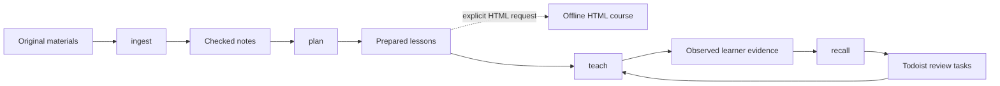

# University Notes

An Obsidian university vault for original course materials, connected study notes, diagrams, and an AI-assisted study workflow. Courses retain their academic year, semester, code and original Unicode names.

Open this repository folder as a vault in Obsidian. Course hubs, `[[wikilinks]]`, embedded figures and Excalidraw drawings provide the study navigation. The existing folder layout and Obsidian configuration are preserved.

## Find your way

| I want to… | Start here |
| --- | --- |
| Find a course, its notes or materials | [Course map](03_Agents/VAULT_MAP.md) |
| Browse original lectures, seminars or textbooks | [00_Materials](00_Materials/) |
| Study connected notes | [01_Notes](01_Notes/), then the course's `<course_folder>_main.md` hub |
| Find shared references or drawings | [02_Resources](02_Resources/) and [Excalidraw](Excalidraw/) |
| Use or maintain the learning assistant | [Agent workspace](03_Agents/README.md) |
| Check what sources were processed | [Ingestion index](03_Agents/runtime/ingest/ingestion_log.md) and its detailed passes |
| Find maintenance findings or old reports | [History index](03_Agents/history/README.md) |

## Structure

```text
University_notes/
├── 00_Materials/          Original course sources
├── 01_Notes/              Study notes, course hubs and assets
├── 02_Resources/          Shared references and drawings
├── 03_Agents/             Learning assistant and workflow records
│   ├── README.md          Workspace navigation
│   ├── VAULT_MAP.md       Dated course inventory
│   ├── skills/            All five canonical skills and their supporting files
│   │   ├── ingest/        Source-to-notes workflow
│   │   ├── plan/          Curriculum preparation
│   │   ├── teach/         Teaching and learner evidence
│   │   ├── recall/        Evidence-based review scheduling
│   │   └── html-course/   Optional offline HTML course export
│   ├── docs/              Architecture, naming and shared workflow documentation
│   ├── <year>/<semester>/<course>/
│   │                      Ingestion, curriculum and learner records
│   ├── agents/            Maintained model-role profiles
│   ├── scripts/           Record, packaging and maintenance utilities
│   ├── runtime/           Ingestion passes, project mappings and handoffs
│   ├── plugins/           Generated package and publication receipt
│   ├── validation/        Fictional contract rehearsals
│   └── history/           Archived reviews, audits and earlier releases
├── Excalidraw/            Editable workflow and standalone drawings
├── .obsidian/             Vault settings, plugins and themes
├── .claudian/             Claudian settings
├── .codex/agents/         Generated copies of maintained role profiles
├── AGENTS.md              Repository instructions for agents
└── README.md              This entry point
```

Materials, notes and course records share the identity `<academic_year>/<semester>/<course>`, for example `2026_2027/Winter_Semester/Comparative_Economics`. Semesters are `Winter_Semester` or `Summer_Semester`. Sources may be organized by week, lecture, seminar or textbook; notes keep their existing course hubs and `assets/` folders. Empty record folders are created only when the workflow needs them.

The main guidance is deliberately small: this README explains the repository, [AGENTS.md](AGENTS.md) defines agent working rules, and the [workspace README](03_Agents/README.md) points to detailed contracts. Old reviews and release archives belong in history.

All five maintained skills live in [03_Agents/skills](03_Agents/skills/README.md). Shared guidance lives in [03_Agents/docs](03_Agents/docs/README.md); only the workspace README and vault map are top-level files in `03_Agents/`.

## Study workflow



| Stage | What it does | Records it owns |
| --- | --- | --- |
| [ingest](03_Agents/skills/ingest/SKILL.md) | Reads an exact source scope or repairs named note passages, records checked coverage and obtains independent source review. | Notes/assets/hubs, ingestion passes and `ingestion_state.json`. |
| [plan](03_Agents/skills/plan/SKILL.md) | Turns checked finished notes into versioned lessons with explanations, exercises, keys and assessment criteria; obtains independent curriculum review. | `learning_plan.md`, `source_manifest.md`, `lessons/`, `curriculum_history/`. |
| [teach](03_Agents/skills/teach/SKILL.md) | Runs prepared lessons, assesses actual responses and saves resumable progress. | `learning_log.md`. |
| [recall](03_Agents/skills/recall/SKILL.md) | Derives review dates from committed evidence and synchronizes owned tasks to verified existing Todoist projects. | `recall_state.json` and the shared project map. |
| [html-course](03_Agents/skills/html-course/SKILL.md) | Optionally renders ready lessons as English offline HTML with LaTeX, week navigation and purposeful interaction. | Versioned exports under `02_Resources/HTML_Courses/<course_id>/`; no academic or learner-record writes. |

Ingestion normally hands off to planning for the affected scope. Teaching needs a matching ready lesson bundle; missing notes or curriculum return to the responsible stage. Recall uses actual recorded evidence. A folder, completed task or elapsed time does not establish coverage or learning.

Typical requests in a host with the skills registered:

- `$ingest 00_Materials/<year>/<semester>/<course>/<scope>` — process that exact source folder and reconcile the affected plan.
- `$uni-teach:plan Prepare <full course identity>, <bounded scope>` — prepare lessons from checked notes.
- `$teach Teach/resume/review <full course identity>, <topic>; I have <budget>` — use prepared lessons. `$uni-teach:teach` is the plugin equivalent.
- `$uni-teach:recall Synchronize my committed course reviews with Todoist` — synchronize evidence-based reviews with existing course projects.
- `$uni-teach:html-course Build <full course identity>, Week 1` — create or refresh an offline course from ready material. “Ingest and build the HTML course” explicitly requests this optional step; ordinary ingestion stays unchanged.

The [architecture](03_Agents/docs/LEARNING_ARCHITECTURE.md) defines ownership, freshness, versions and handoffs. [Lesson content](03_Agents/docs/LESSON_CONTENT.md) defines self-contained preparation and bounded teaching additions. Actual course records and pass details establish current scope; the course map is navigation only.

## Maintenance

Run from the repository root:

```sh
# Check live local files, links, headings, embeds and course mirrors.
python3 03_Agents/scripts/check_vault.py

# Run maintenance regressions; Python 3.11+ includes TOML validation.
python3 -m unittest discover -s 03_Agents/scripts -p 'test_*.py'

# Check generated plugin/role copies and the current versioned ZIP against sources.
python3 03_Agents/scripts/sync_plugin.py --check
```

See the [utility guide](03_Agents/scripts/README.md) for record verification and the [package guide](03_Agents/plugins/README.md) for regeneration and release status. Edit canonical sources; generated packages, project role copies, publication and host activation are separate concerns.

The [repository audit](03_Agents/history/2026-10-17-repository-audit/REPORT.md) records the structural cleanup. Its six note-reference findings were subsequently repaired with source checks; see the [repair summary](03_Agents/history/2026-10-17-repository-audit/NOTE_REFERENCE_REPAIRS.md). Fresh Git worktrees can still report absent empty course mirrors. The checker reports structural problems; it does not certify academic correctness or PDF page bounds.

The primary vault is `/Users/slavomirhoricka/Desktop/University_notes`. An isolated task uses its own checkout root for all workflow paths. Historical records may retain older paths as dated provenance. Keep original materials, learner evidence, curriculum history and transaction journals intact. Todoist requires its separate connector; no background watcher is installed by this repository.

The [workflow consistency audit](03_Agents/history/2026-10-18-workflow-consistency-audit/REPORT.md) records the reconciliation of skills, templates, scripts and these main docs, including retry and release-preservation checks.
