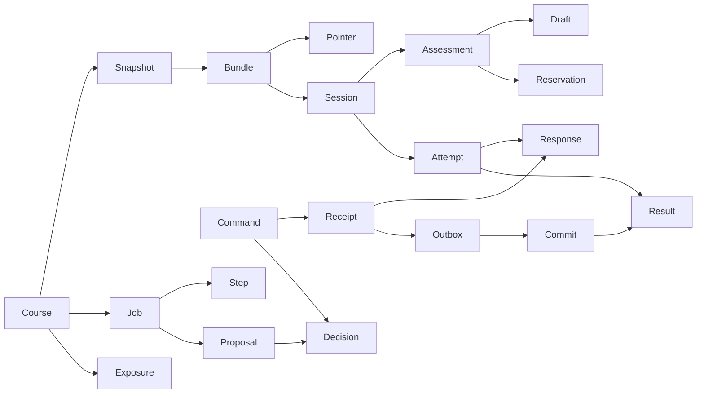

# H02 typed foundation contracts

Input accepted integration: `fcedead7def791b589817063f91245475c03835b`. Checkout: `/Users/slavomirhoricka/.codex/worktrees/hub-foundation/University_notes`, branch `codex/hub-foundation`. Requested native role: hub_foundation, gpt-6.1-sol/high. Host declaration confirms fixed role configuration; independent execution telemetry is unknown. No canonical course writes or production course fixture registrations.

API version v1 / OpenAPI application version 1.0.0 / bundle schema revision 1 are proposed for root interface review. Canonical schema 4 is proposed-only. The H09 exact maintained patch and production validation are in [h09-canonical-proposal.md](h09-canonical-proposal.md).

## Contracts and seams

Strict frozen Pydantic contracts forbid extra fields, use discriminated response/finalization/event unions, complete version tuples and real prefixed UUIDv4 IDs. Course identity uses full exact Unicode path and a separate opaque key; NFC collisions cannot silently merge. The private manifest validates dependency graphs, question/component/coverage/section/blueprint/activity references and prepared point sums. Decimal strings are bounded grammar inputs; sums use precision 80. Public allowlist projections exclude the bank, targets/keys/rubrics/feedback and future retention prompts; selected retention delivery requires a later explicit authorization path.

Typed ports expose receipt replay, actual evidence intent/proof, curriculum/publication/source inventory, local authorization, protected credential store, provider run/cancel/status, course reservations, Git integration inspection, durable requested jobs and event replay. H01 injects local authorization/credential/provider seams without waiting for H03. H07 can use `SQLiteRequestedJobs` to durably queue work before H08 worker execution exists. No provider or owner implementation is fabricated.

EvidenceIntent carries exact typed uncommitted event payloads, stable IDs, owner transaction and digest. Proposed events retain existing vocabulary. Operational draft/upload/job/provider/approval receipts and bookmarks cannot become evidence. Progress and pending grading preserve unknown outcomes. Draft-snapshot/existing-response finalization modes are distinct contracts; H11 implements the one-transaction receipt/response/freeze behavior. H02 validates manifest, blanks, selection and revision conflicts without submitting academic evidence.

OpenAPI's explicit public registry exports downstream command/response components while the health endpoint remains the sole implemented route. It excludes private prepared items, credentials and owner intents. `scripts/export_contracts.py` owns both generated artifacts; `--check` independently regenerates and compares exact OpenAPI/TS bytes. Consumers request model/schema changes from foundation before using them.

## Operational schema and upgrades

Five ordered SQL migrations implement the normative catalogue. Foreign keys, STRICT tables, JSON syntax, exact enums/uniqueness, immutable histories, publication CAS, same-course guards, auth terminal state, immutable digest-bound human approvals and draft guards apply in the version that introduces each feature. v3 already guards exposure/reservation/review course relationships. Completed checkpoints cannot be deleted before exact-input invalidation, and lease rows retain fences across acquisitions. v4 seeds recommended academic role settings from the accepted canonical `.codex/agents/uni_*.toml` registry; rows are requested defaults, never provider eligibility or actual-runtime proof.

Forward final-result detail accepted by root: v2 supports assessment active/submitted rows but rejects any non-null final_result_id on INSERT and UPDATE. v3 introduces verified grading results then replaces that prohibition with existence/assessment/session guards. A non-null assignment requires finalized state and a result from an actual response and matching verified commit. Upgrade preserves the original v2 assessment rows.

`connect_database` sets foreign_keys ON, WAL, FULL synchronous and busy timeout 5000; it registers deterministic NFC matching and creates owner-only storage. `migrate` checks immutable ledger names/SHA-256 checksums and integrity, rejects unknown newer/unversioned/downgrade cases, requires a new absolute consistent backup for an existing upgrade, and runs each numbered migration in its own immediate transaction. Failed versions roll back; earlier versions remain usable. H14 must quiesce workers and separately preserve/reconcile canonical history and bundle/upload manifests before swap. SQLite restoration is not proof of canonical reconciliation.

## Acceptance evidence

- H02-A1: strict tuple/UUID/unknown-field tests and dangling question/component/activity/dependency reference failures.
- H02-A2: reviewable public bundle snapshot and private sentinel/target/key/rubric/retention exclusion; actual public OpenAPI registry exclusions.
- H02-A3: fixture-only union reader verifies byte-identical legacy/schema-3 history and metadata boundaries; malformed extension/components/conditions rejected; live gate stays false.
- H02-A4: actual export generation/drift target plus clean/prior-version/checksum/conflict/crash/backup/immutable SQL tests.

Final verification (project-local Python 3.12.15 / Node 24.21.0): `make check-all build` exited 0 (6 unit, 39 contract, 19 integration, 2 UI component and 1 real Playwright tests, strict lint/type checks, export drift and both builds). After final earliest-version/DELETE/precision fixes, Ruff/mypy and `pytest tests/contracts tests/integration -q` exited 0 with 63 tests (40 contract / 23 integration); `make check-contracts build` exited 0. Five migration resources are present in the built wheel. Final `git diff --check` and exact baseline vault-report comparison are recorded in the completion receipt. The pre-existing vault checker fails remain unchanged; upstream Starlette/httpx deprecation stays visible. H02 stops for independent interface review; no H03 work begins before acceptance.
